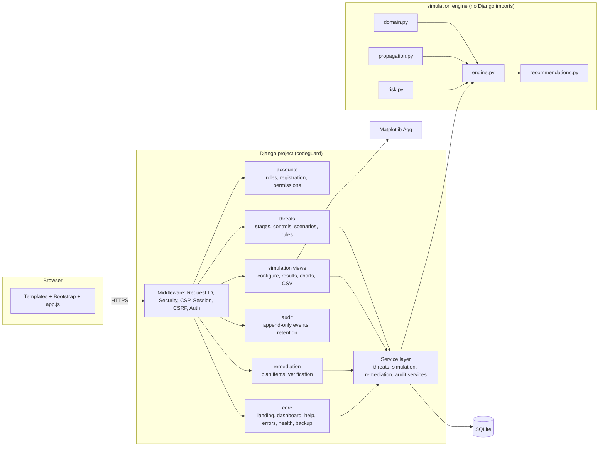
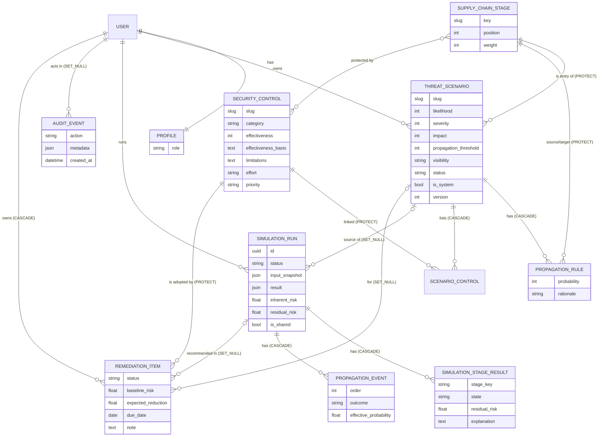
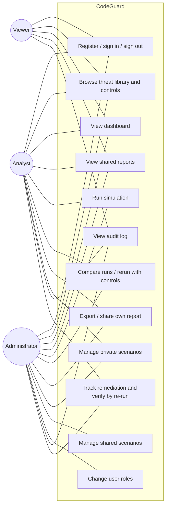
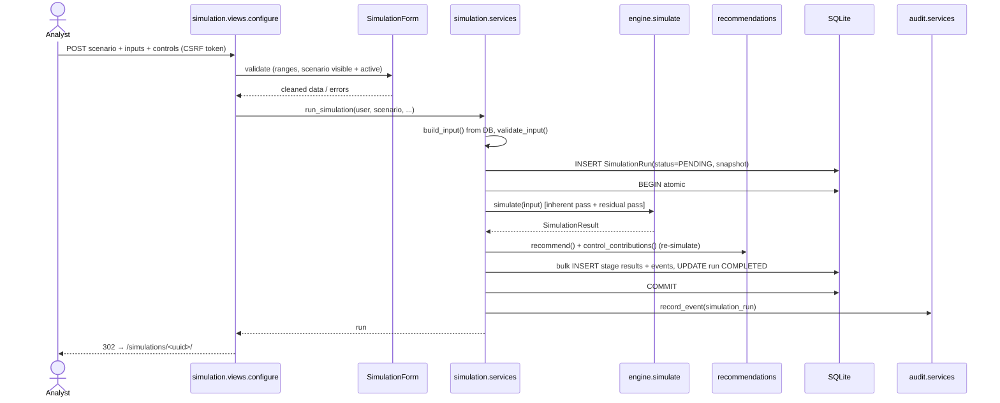
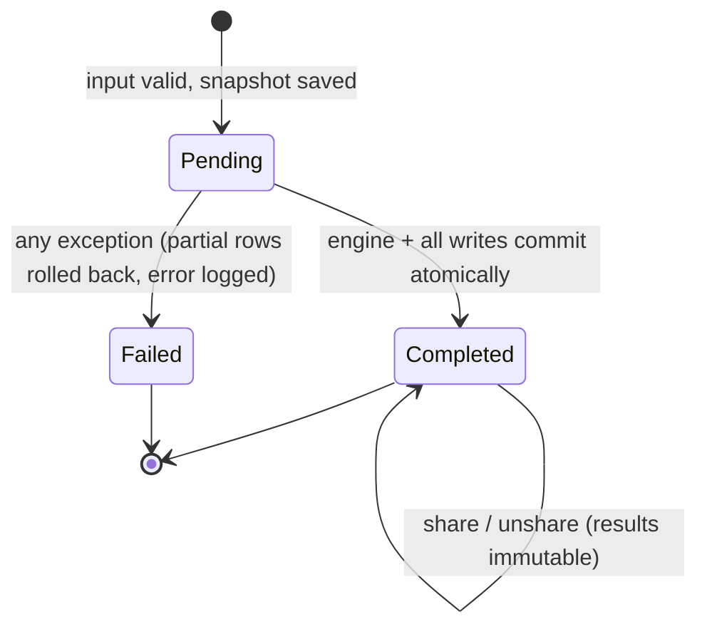
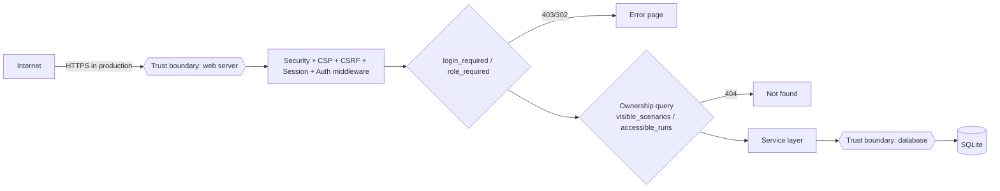

# CodeGuard — Architecture

## 1. Overview

CodeGuard is a Django monolith made of six apps plus a pure-Python simulation engine. The browser talks only to Django views. Views validate input with forms, check permissions, and delegate to service modules. The simulation engine is isolated from Django so it can be tested and reasoned about on its own.



## 2. Component responsibilities

| Component | Responsibility | Key files |
|---|---|---|
| `codeguard` | Settings from environment variables, URL routing, error handlers, test settings | `settings.py`, `test_settings.py`, `urls.py` |
| `accounts` | `Profile.role`, registration without a role field and with a registration policy, sign-in throttling, role decorators, admin role management, auth audit signals, deployment check | `models.py`, `permissions.py`, `throttling.py`, `forms.py`, `signals.py`, `checks.py`, `views.py` |
| `threats` | Supply chain stages, control catalog, scenarios, propagation rules, scenario CRUD, visibility and ownership rules, seed command | `models.py`, `services.py`, `forms.py`, `seed_data.py`, `management/commands/seed_codeguard.py` |
| `simulation` (engine) | Deterministic traversal, risk formulas, recommendations, serialisation | `domain.py`, `engine.py`, `propagation.py`, `risk.py`, `recommendations.py`, `serialization.py` |
| `simulation` (app) | Run persistence and lifecycle, access control, charts, SVG geometry, CSV export, comparison | `models.py`, `services.py`, `views.py`, `charts.py`, `visual.py`, `exports.py` |
| `remediation` | Remediation plan: items created from report recommendations, status and notes, verification against later runs | `models.py`, `services.py`, `views.py` |
| `audit` | Sanitised, append-only event log (instance and queryset guards), role-scoped viewer, retention command | `models.py`, `services.py`, `views.py`, `management/commands/purge_audit_events.py` |
| `core` | Landing page, overview metrics, supply chain explorer and risk analysis (`analytics.py`, `svgcharts.py`), derived notifications (`notifications.py`), shell context, methodology page, CSP and request-ID middleware, structured logging, health check, backup command, template filters, error pages | `services.py`, `views.py`, `middleware.py`, `observability.py`, `theme.py`, `management/commands/backup_db.py`, `templatetags/codeguard_tags.py` |

## 3. Major design decisions

1. **The engine is separate from Django.** It receives immutable dataclasses and returns dataclasses. This makes it trivially unit-testable (91 database-free tests run in about one second) and impossible for it to touch the database.
2. **Deterministic threshold propagation.** An edge propagates when `effective probability ≥ threshold`. The results are reproducible and can be explained in a sentence, at the cost of statistical realism. That trade-off is documented in the UI.
3. **Two passes per run.** The *inherent* pass uses no controls and the *residual* pass uses the enabled controls, so every report is already a before/after comparison of controls versus none.
4. **Preventive versus mitigating controls.** Preventive controls reduce the probability of edges entering the stages they protect. Detective and recovery controls cannot stop propagation, so they reduce the residual risk of the stages that are reached.
5. **Weighted-average aggregation.** The maximum stage risk is almost always the entry stage, which would make downstream controls appear useless. A weighted average (production carries weight 3) rewards defence in depth and stays within 0–100.
6. **Recommendations by re-simulation.** Each candidate control is evaluated by actually re-running the engine with it added. The reported reduction is therefore exact for the model, rather than a heuristic.
7. **Snapshots for history.** `SimulationRun.input_snapshot` stores the scenario version, rules, stages and controls, and `result` stores the full engine output. Child rows are denormalised (they store names, not foreign keys), and `scenario` uses `SET_NULL`. Historical reports therefore never change.
8. **In-memory charts.** PNGs are rendered per request behind the same access check as the report. No files are written, so there are no paths to guess and nothing to clean up.
9. **Vendored static assets and a strict CSP.** Bootstrap and icons are vendored; there are no inline styles (risk meters use `<progress>`). The only inline script is the pre-paint theme script, allowed by its SHA-256 hash. The only third-party origin is Google Fonts for the heading face (a documented trade-off).
10. **The deployment is the tenancy boundary.** One organization per instance; "shared" means shared within that deployment. Self-registration is therefore governed by `CODEGUARD_REGISTRATION` (`open`, `domain`, `closed`), and `check --deploy` warns when it is open in production. Multi-tenant organizations were considered and deferred until several unrelated teams must share one deployment (see [engineering-assessment.md](engineering-assessment.md), H2).
11. **Throttling from the audit log.** Sign-in limits (per username and per client IP) count `login_failed` events in the database rather than a per-process cache, so they hold across worker processes with no extra infrastructure. A locked account is refused before the password is checked.
12. **Remediation verification is derived, not stored.** An item is verified when a later run of the same scenario by the same user has the control enabled. Computing this on read means it can never disagree with the run history.
13. **SQLite now, PostgreSQL when.** See section 9.

## 4. Data model



The deletion behaviour is chosen deliberately:

- Stages and catalog controls are `PROTECT`, because reference data must not disappear under a scenario.
- Deleting a scenario cascades to its rules and links, but runs keep their snapshot (`SET_NULL`).
- Deleting a user removes their private scenarios, runs and remediation items (`CASCADE`), while audit events keep the username (`SET_NULL`).
- A remediation item keeps its scenario name, slug, baseline risk and expected reduction, so it stays readable if the source run or scenario is deleted (`SET_NULL`); its control is `PROTECT`.

See [data-dictionary.md](data-dictionary.md) for the field-level details.

## 5. Use cases



(The audit log is scoped: administrators see all events, everyone else only their own.)

## 6. Simulation workflow



### Propagation algorithm (activity view)

```mermaid
flowchart TD
    start([Start]) --> entry[Mark entry stage compromised<br/>L = base × (1 − preventive coverage)]
    entry --> q{Queue empty?}
    q -- no --> pop[Pop compromised stage u]
    pop --> edges[For each outgoing edge u→v, sorted by v.position]
    edges --> eff[p_eff = p × (1 − coverage(v))]
    eff --> dec{p_eff ≥ threshold?}
    dec -- yes --> already{v already compromised?}
    already -- no --> mark[Mark v compromised; enqueue v] --> edges
    already -- yes --> rec1[Record 'propagated, already compromised'] --> edges
    dec -- no --> why{p ≥ threshold?}
    why -- yes --> blocked[Record 'blocked by controls'] --> edges
    why -- no --> below[Record 'below threshold'] --> edges
    edges -- done --> q
    q -- yes --> lik[Max-product path likelihood per stage]
    lik --> score[Stage risk = L × S/5 × I/5 × (1 − mitigating coverage)]
    score --> agg[Overall = weighted average] --> stop([Result])
```

### Run states



Invalid configurations (`SimulationConfigError`) are rejected **before** a run is created, so they never appear in history.

## 7. Request workflow and security boundaries



- Authorisation happens on the server in two layers: role decorators (`accounts/permissions.py`) and ownership-filtered querysets (`threats.services.visible_scenarios`, `simulation.services.accessible_runs`). Objects outside these querysets return 404, so their existence is never disclosed.
- Forms validate every input. The simulation form's scenario queryset is restricted to active scenarios the user can see, which defeats forged POSTs.
- See [threat-model.md](threat-model.md) for the full analysis.

## 8. Maintainability and testing

- **Thin views, rich services.** Views coordinate; `services.py` modules hold the business rules; the engine holds the mathematics. Templates contain no calculations: the SVG geometry is computed in `simulation/visual.py`.
- **Each layer has matching tests.** The engine has pure unit tests, the services and views use pytest-django with the test client, and `tests/test_integration.py` covers the end-to-end journeys plus the migration and system checks.
- **Reproducible environments.** Dependencies are pinned, `test_settings.py` gives tests isolated settings, and Ruff enforces lint and format.
- **CI quality gates** (`Jenkinsfile`) fail the build on lint errors, missing migrations, failing tests or core coverage below 85%.

## 9. Operations

- **Health:** `GET /healthz/` returns `{"status": "ok", "database": "ok"}` (200) or a 503 with no internal detail. It needs no session and is exempt from the HTTPS redirect, so internal probes can use plain HTTP.
- **Correlation:** every response carries `X-Request-ID` (a well-formed incoming value from a proxy is reused), and every log line written during the request includes it.
- **Logging:** to stdout/stderr; `CODEGUARD_LOG_FORMAT=json` writes one JSON object per line for log collectors.
- **Backups:** `manage.py backup_db` takes an online copy through SQLite's backup API, verifies it with `PRAGMA integrity_check` and keeps the newest N. Restore steps are in [deployment.md](deployment.md).
- **Retention:** `manage.py purge_audit_events --days N` (minimum 30) is the only supported way to delete audit history, and it records its own run.

### Database: SQLite now, PostgreSQL when

SQLite stays the database because the project requires it and the expected deployment (one team, tens of users, simulations that take milliseconds) is well within what it handles. It is configured for that deployment: WAL journaling (readers do not block the writer), `BEGIN IMMEDIATE` transactions with a 20-second busy timeout (concurrent writers queue instead of failing mid-transaction) and `synchronous=NORMAL`. Measured on the development machine with 4 worker processes running 50 simulations each against one database file: with Django's defaults, 156 of 200 runs failed; with these settings, all 200 completed.

Move to PostgreSQL when any of these holds: more than one application server needs the same database; sustained concurrent writes exceed what one SQLite writer can serialize; the database must be backed up or replicated by managed infrastructure; or multi-tenant organizations are introduced. The code uses the Django ORM plus two SQLite-specific places (the `DATABASES` options and `backup_db`), so the switch is a configuration and operations change, not a rewrite.
