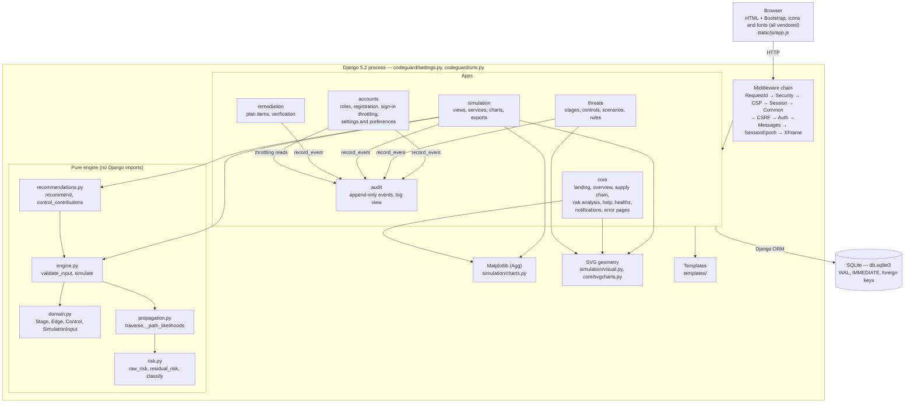

# Diagram: system architecture

One Django process (any number of identical WSGI workers) serves server-rendered HTML, PNG
charts and CSV files from one SQLite file. Arrows show "calls / imports". The simulation engine
(`domain`, `engine`, `propagation`, `risk`, `recommendations`) imports nothing from Django.

Source files: `codeguard/settings.py` (`INSTALLED_APPS`, `MIDDLEWARE`, `DATABASES`),
`codeguard/urls.py`, `simulation/engine.py` (module docstring: "It never touches the database").
