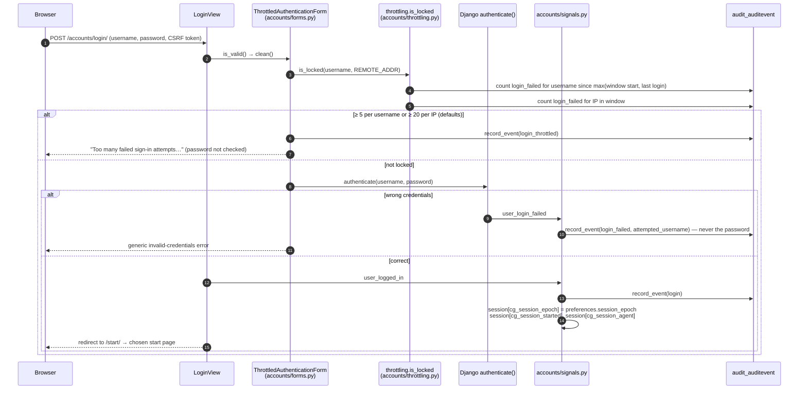
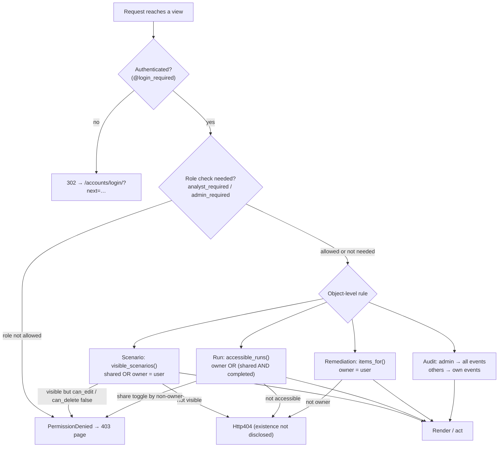

# Diagram: authentication and authorization

## Sign-in with throttling

## Authorization decision for a protected view

Role resolution (`accounts/permissions.get_role`): anonymous → `None`; superuser → `admin`;
otherwise `user.profile.role`, or `viewer` when the profile row is missing.
