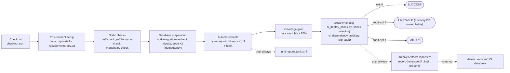
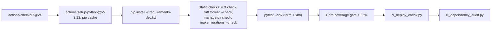

# Diagram: CI/CD

Two pipeline definitions exist. **Neither deploys anything.** Status, as far as can be verified
from this machine:

- `Jenkinsfile` — configured, **never executed on a Jenkins server**. Its commands were
  rehearsed by `scripts/rehearse_jenkinsfile.py` (README: SUCCESS on 2026-10-26).
- `.github/workflows/ci.yml` — configured. Whether it has run on GitHub could not be checked
  here (`gh` is not installed). Until commit `eef6716`, `templates/reports/` was git-ignored and a
  checkout of `main` failed 9 tests (reproduced with a fresh clone on 2026-11-10); a fresh clone
  of `eef6716` passes all 337.

## Jenkinsfile stages

## GitHub Actions job (`test`, ubuntu-latest, Python 3.12)

Triggers: push to `main` and every pull request. Permissions: `contents: read`. Unlike Jenkins it
does not run `migrate`/`seed` separately (pytest builds its own database) and treats any non-zero
exit from the dependency audit, including the "unreachable" code 2, as a failure.

## Local equivalents

`scripts/ci_local.ps1` and `scripts/ci_local.sh` run the same gates on a developer machine;
`scripts/rehearse_jenkinsfile.py` clones the repository into a temporary directory and runs every
`runCmd` command extracted from the Jenkinsfile, in order.
