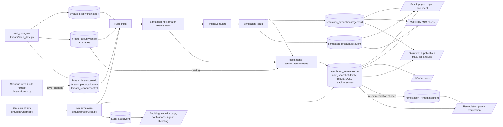

# Diagram: data flow

Where data comes from, where it is stored and what reads it. Rectangles are code, cylinders are
tables (or JSON columns), parallelograms are outputs.

Key property: report pages read only stored rows and JSON (`SimulationRun.input_snapshot`,
`result`, stage results, events). Editing or deleting the scenario later does not change them;
`simulation.services.input_from_snapshot` can rebuild the exact engine input.
