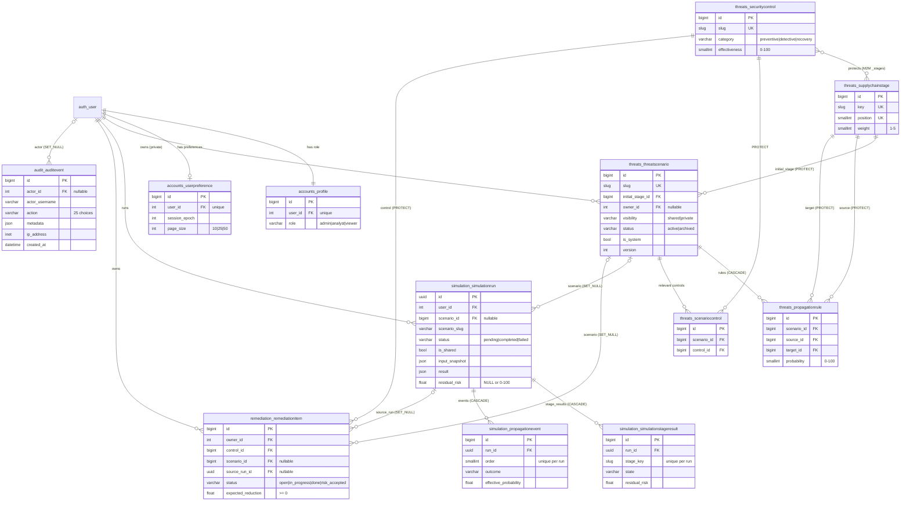

# Diagram: entity-relationship model

Only CodeGuard tables and `auth_user` are shown. Field lists are abbreviated to keys and the
fields that matter for relationships and rules; the full list is in
`references/models-and-tables.md`.

Stage results and events store stage **keys and names as text**, not foreign keys to
`threats_supplychainstage`. That is deliberate: a historical report must survive later changes
to the stage catalogue.
