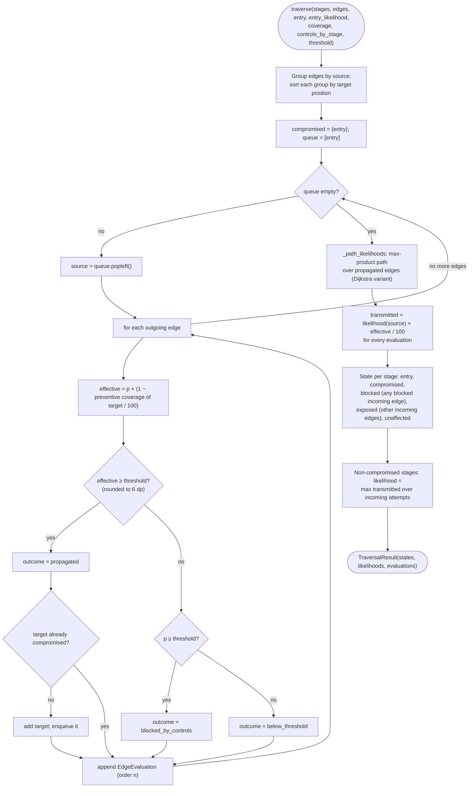
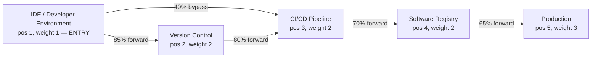

# Diagram: propagation algorithm

## Activity view of `simulation.propagation.traverse`

## The seeded "Compromised Developer Account" graph

Edge labels are the scenario's propagation probabilities (`threats/seed_data.py`). Edge kinds come
from `edge_kind`: next position = forward, later position = bypass, earlier = reverse.

With no controls and threshold 50 %, every edge except `ide → cicd` (40 % < 50 %) propagates and
all five stages are compromised. The worked example in `SIMULATION_AND_RISK_METHODOLOGY.md` adds
MFA, protected branches and SCA, which block `ide → vcs` and leave only the entry stage
compromised.
