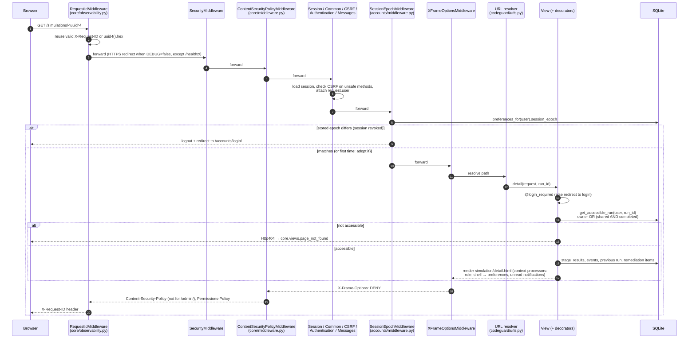

# Diagram: request lifecycle

The order of the middleware is the order in `MIDDLEWARE` (`codeguard/settings.py`). On the way
out, responses pass back through the same middleware in reverse.

Every log line written during the request carries the ID via `RequestIdFilter` (configured in
`LOGGING`).
